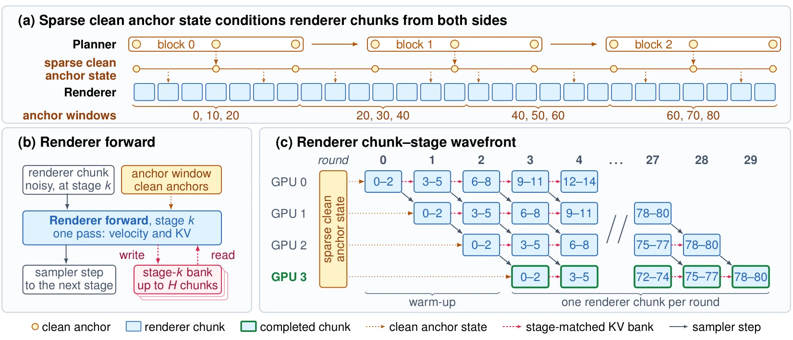
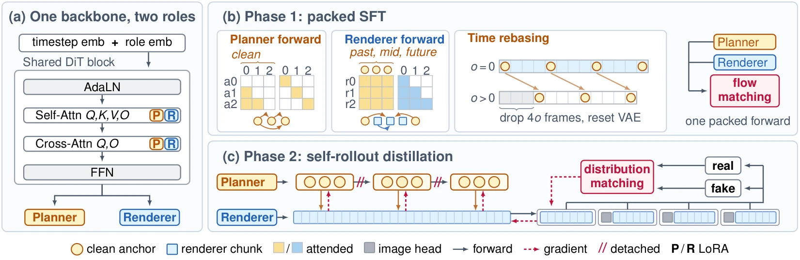

#+TITLE: FlashForward：In-Flight KV Cache 与 Clean Anchors
#+SLUG: flashforward-2026
#+TYPE: paper-reading
#+STATUS: drafting
#+PROGRESS: 30
#+TARGET_ALIAS: categories/AI/视频生成
#+TARGET_SUB_ID: auto
#+TARGET_HUB: 
#+PIN: false
#+SOURCE_URL: https://arxiv.org/abs/2609.32540
#+TAGS: [视频生成, KVCache, 推理加速]
#+CREATED_AT: 2026-11-03T10:24:18
#+UPDATED_AT: 2026-11-03T12:14:04
#+PUBLISHED_AT: 
#+PUBLISHED_FILE: 

* FlashForward：In-Flight KV Cache 与 Clean Anchors

来源：arXiv 2609.32540，首次提交 2026-09-26，https://arxiv.org/abs/2609.32540
版本：本地 deepxiv 正文标注 v1，下载的 arXiv HTML 标注 v2；下文引用明确对应本地文件与章节，后续发表前需统一版本。
作者：Yikai Wang, Xiao Han, Mengmeng Xu, Juan C. Pérez, Yiannis Douratsos, Sen He, Zijian Zhou, Fei Zhang, Zhaochong An, Juan-Manuel Pérez-Rúa, Chen Change Loy, Tao Xiang
发表：Meta（Chen Change Loy: S-Lab, NTU），项目页 https://yikai-wang.github.io/FlashForward

** 用户口述：阅读顺序与待核对的理解

以下为用户提供的实质口述，保留问题和推测；其中的判断尚不能直接作为论文事实使用。

#+begin_quote
要写这一篇，首先我们需要说明流式视频生成的流程。然后我们要对 Self-Forcing 以及 HiAR 的流程进行足够的回顾。特别是 Self-Forcing 里面为什么会出现 cache-update-only forward。如果是多步去噪，这个流程是不是影响不大？只在少步去噪的情况下，这多出来的一步就比较影响了。

另外我们能不能将这一步看作是 prefill 的过程？

是不是每生成一个新的块，都需要多跑一步 cache-update-only forward？这就相当于是 decode 的过程对吧？还是说每生成一个新的块，跑的 cache-update-only forward 都要更新所有的 KV cache 内容？应该不是吧？那就是 decode 了。去噪的过程是准备需要的latent，然后最后再完成一步 decode。

self-forcing 这种办法是为了确保 KV cache 中的历史必须是干净的。但 FlashForward 放弃了干净的历史，选择使用相同去噪阶段的历史。这样就可以通过多 GPU 流水线处理，提高生成速度了。

那 diffusion forcing 又是什么方案？它有允许历史带噪吗？

flash forward 又发现，历史不能全带噪，必须要有干净历史来平衡。因此又添加了一个规划器。视频生成的进化史中，有一些方案就是由粗到细的。

规划器和渲染器共用生成器主干，只是attention 不同，最后的输出层不同，对吧。
#+end_quote

** 流式生成与两条时间轴

分块自回归视频扩散沿视频时间逐块生成，但每个块内部还要沿去噪时间迭代。视频时间决定“现在生成哪一段”，去噪时间决定“这一段还带多少噪声”。把两条轴分开后，才能说明哪份 KV 已经可用，以及下一块为什么需要等待。[FF §1、§3；SF §3.1]

设当前生成第 \(i\) 个视频块，其表示为 latent。latent 是经过视频编码器压缩后的表示，不能直接当成可播放的 RGB 帧。以文本生视频为例，当前块从随机噪声开始；模型读取文本条件和此前各块的历史，在每次前向中预测去噪更新，直到得到当前块的干净 latent。[FF §3；SF §3.1]

以 Self-Forcing 的 clean-history 推理为例，一块视频经历以下操作：

1. 采样当前块的随机噪声。
2. 重复去噪前向；每次都读取此前各块留下的 clean KV。
3. 得到当前块的干净 latent。
4. 把这份干净 latent 再送入生成器，计算当前块的 clean KV，追加到历史缓存。
5. 下一块以这份更新后的历史为条件，从自己的随机噪声开始生成。

当前块的干净 latent 还需通过 VAE decoder 转成 RGB 画面。VAE 解码与为下一块准备 KV 是两条用途不同的路径；上面的编号不要求二者按固定顺序串行执行。FlashForward 的延迟统计排除了文本编码与 VAE 解码，因此它报告的是去噪路径延迟，不能直接当成从提示词到播放画面的端到端时间。[FF Appendix A.2]

这里的“流式”表示可以随生成过程逐块提供输出。若系统已经提前规划未来锚点，它也可能流式输出，但不代表能够毫无约束地响应每一刻的新指令。后文会区分 FlashForward 的四卡先规划版本，以及专用 planner GPU 的并发流式版本。[FF Appendix A.1、A.2.3]

** Self-Forcing：干净输出与干净缓存

*** 最后一次去噪仍以带噪 latent 为输入

最后一次去噪得到干净输出，并不意味着同次前向内部已经产生了这份干净输出的 KV。模型内部的 K/V 来自它正在处理的输入；预测出的干净 latent 位于计算的输出端，还没有作为输入重新穿过各层。[FF §1、Table 1；SF Algorithm 2]

令 \(x_{i,\sigma_1}\) 为当前块在最后一个去噪阶段的输入，其中 \(\sigma_1>0\)。将最后的模型预测与采样更新合写，可记为：

\[
x_{i,\sigma_1}
\xrightarrow{\text{最后一次去噪}}
\hat{x}_{i,0}.
\]

这次前向顺带产生的 KV 对应 \(x_{i,\sigma_1}\) 及相应 timestep，而不是对 \(\hat{x}_{i,0}\) 做一次干净输入编码的结果。要让后续块读取后者，需要额外计算：

\[
(K_i^{\mathrm{clean}},V_i^{\mathrm{clean}})
=G_\theta^{\mathrm{KV}}
\bigl(\hat{x}_{i,0};\,0,\mathcal K_{<i}\bigr).
\]

其中 \(\mathcal K_{<i}\) 是已有历史缓存，时间输入 0 表示干净端点。这次调用计算当前块在网络各层的表示，并保存其中的 K/V。深层表示需要经过前面各层的 attention 和其他运算，因此这项工作不能简化成在最终 latent 上单独做 K、V 两次投影。[SF Algorithm 2；FF §1]

这就是 cache-update-only forward，本文称“专用缓存前向”或“clean-context 编码”。当前块已经生成完成，这次前向只准备后继块需要的条件，不继续推进视频 latent 的去噪。[FF §1、§2]

*** 每块追加新 KV，保留的历史不重算

Self-Forcing 的推理伪代码先调用 \(G_\theta^{\mathrm{KV}}\) 得到当前块的缓存条目，再将它追加到已有缓存。如果缓存已满，算法移除最旧条目。新增的是当前块在各层的 KV，已有条目供当前计算读取，不需要全部重新通过模型。[SF Algorithm 2、§3.4]

只要后面还有块要生成，通常就需要完成当前块的 clean-context 编码。若当前块已是整段输出的最后一块，且没有后续消费者，可以省略它的缓存写入。FlashForward 在计算基线的逻辑前向当量时，也省略了最后一块无人使用的更新。[FF Appendix A.2.2 Eq.(3)]

滚动窗口移出旧条目，不等于在截断后的窗口上重新编码全部历史。保留下来的深层 KV 仍可能包含计算时更早上下文的影响。文章需要把“追加当前块的缓存”和“窗口移动后重算已有块”分开，避免把两类成本混为一谈。[SF §3.4、Figure 3]

*** 少步去噪放大额外前向的相对成本

专用缓存前向在多步采样中同样存在，但当去噪步数变少时，它占每块成本的比例会上升。为看清这一关系，先做等成本的教学估算，不把它当作实测延迟。[FF §1；以下比例为教学推导]

假设每次去噪前向成本为 \(C\)，一次 clean-context 编码成本也为 \(C\)，每块有 \(S\) 次去噪，则：

\[
T_{\mathrm{chunk}}\approx SC+C,
\qquad
\frac{T_{\mathrm{cache}}}{T_{\mathrm{denoise}}}\approx\frac1S,
\qquad
\frac{T_{\mathrm{cache}}}{T_{\mathrm{chunk}}}\approx\frac1{S+1}.
\]

| 去噪步数 | 缓存前向相对去噪成本 | 缓存前向占总成本 |
|----------+----------------------+------------------|
| 50       | 2%                   | 约 1.96%         |
| 4        | 25%                  | 20%              |
| 1        | 100%                 | 50%              |

这组比例忽略不同调用的实际成本差异、CFG、通信和缓存读写，也忽略最后一块可省的更新。它解释了少步设置下的瓶颈，但不能直接预测 GPU 墙钟时间。此外，Self-Forcing 的下一块要等当前块的 clean KV 就绪，因此这一步也位于块间的串行依赖上。[FF §2、Appendix A.2.2]

*** Prefill 与 decode 类比的边界

clean-context 编码把已经确定的 latent 写成后续可读的条件，可以类比“增量预填充”。它保留旧缓存、追加新位置的方式，也类似 LLM decode 的缓存追加部分。但“是否只追加新位置”不足以判断一个步骤是不是 decode。[本站 KV Cache 基础 §1.5-1.6、§2.4-2.5；本段类比为编辑解释]

LLM 的普通 decode 前向把已经选出的 token 送入模型，既保存它的 KV，又预测下一个 token。视频中的这次专用缓存前向只编码已经生成的当前块；下一块还要另从随机噪声开始，通过去噪得到输出。因此，不能把整体过程写成“去噪只是准备 latent，最后再 decode 一次”。去噪已经完成了当前块的生成。[SF Algorithm 2]

本文固定使用三个名称：生成器的“去噪前向”、生成器的“clean-context 编码”，以及 VAE 的“画面解码”。它们分别更新 latent、构建未来条件、把 latent 转成 RGB，避免用 decode 同时指代不同计算。

Self-Forcing 的训练贡献也需要独立交代：作者让模型在训练中使用自己生成的历史，缓解 exposure bias，即训练时看到的上下文与推理时不同。这里回顾 clean KV，是为解释它采用的执行方式，不能把整篇方法概括成“确保历史干净”。而 clean 只表示输入处在无额外扩散噪声的端点，生成内容仍可能有错误。[SF §3.1-3.3]

** HiAR：读取更干净一级的上下文

HiAR 将后继块所需的历史从“已完成全部去噪”放宽到“已完成当前一级更新”。若当前块正从 \(\sigma_k\) 更新到 \(\sigma_{k-1}\)，它读取的是前序块在 \(\sigma_{k-1}\) 的表征。这个上下文比当前输入更干净，但不必已到 \(\sigma_0=0\)。因此，后继块可以在前序块尚未生成完时开始去噪。[HiAR §3.2；FF Table 1]

这项放宽允许相邻块错开去噪阶段：前一块进入下一阶段时，后一块跟着处理当前阶段。不同 GPU 分别负责不同阶段，即可沿“块编号 × 去噪阶段”的反对角线并发执行。HiAR 已经利用这种流水线，FlashForward 进一步改变的是流水线中要读取和发布的 KV。[HiAR §3.2；FF §2]

不过，前序块在去噪时顺带产生的 KV 来自其输入 \(x_{i,\sigma_k}\)。HiAR 要消费更新后 \(x_{i,\sigma_{k-1}}\) 的表征，因此仍要对更新后的前序块做上下文编码。这项工作不会因为允许历史带噪就自动消失。[HiAR §3.2；FF §1、Table 1]

HiAR 将前一块的上下文编码与后一块的去噪融合进同一次调用：拼接两块输入，分别提供输出噪声等级与当前输入噪声等级，再用因果 attention 让后一块读取前一块刚产生的 KV。这里仍计算了前一块的新表示，但不能把所有上下文编码都说成独立的额外调用。[HiAR §3.2]

后续比较要同时写清“逻辑块前向当量”和“实际模型调用”。FlashForward 的前向计数用于表达前者；一次融合调用可以处理超过一个块的计算内容，因此只数调用次数会掩盖计算量。HiAR 原文称每阶段 \(N+2\) 次调用，但括号列出的 \(1+(N-1)+1\) 等于 \(N+1\)；这处计数疑点保留在资料核查中，不用它推导精确加速比。[FF Appendix A.2.2；HiAR §3.2]

** Diffusion Forcing：不同位置可以处于不同噪声等级

Diffusion Forcing 为序列中不同位置独立采样训练噪声等级。模型因而要学习在各种噪声组合下预测干净内容，先前位置可以干净，也可以带噪。这项训练原则比某一种固定的流水线日程更广。[DF §3.2、Algorithm 1]

推理时，采样日程指定每个位置在每轮应达到的噪声等级。例如，可以先完全去噪第一块，再处理第二块；也可以在前面块尚未完成时，让后面块开始去噪。训练时“独立采样噪声等级”和推理时“选择不同位置的更新顺序”需要分开叙述，不能写成推理每轮都独立随机决定噪声等级。[DF §3.2、Algorithm 2]

原论文还利用略带噪声的历史状态稳定长程自回归，使模型不必把自己的生成结果当成完全可信的真实观测。这说明“历史带噪”既可以为调度提供空间，也可以用于表达生成历史的不确定性。这里的稍带噪历史与 FlashForward 固定读取同阶段历史的约定并不等同。[DF §3.3、Appendix B.4]

原始 Diffusion Forcing 的主要实现使用 RNN hidden state，并讨论了 Transformer 的可能实现；它没有把特定的 Transformer KV 缓存算法作为方法定义。因此，“模型允许怎样的带噪上下文”和“哪些层的 KV 可以复用、何时可供后续块使用”是两个需要分别回答的问题。[DF §3.2、Appendix B.1]

** FlashForward：复用同阶段 KV，补充干净锚点

*** 同阶段历史让缓存随去噪产生

FlashForward 让后继块直接读取前序块在相同去噪阶段产生的 KV。当前块处于阶段 \(k\) 时，所读历史也是此前各块通过阶段 \(k\) 时留下的表征。模型的训练和推理均按这个约定组织，因此应理解为改变了所需条件，而不是拿来一份不匹配的缓存勉强使用。[FF §3.1 Eq.(2)]

普通 renderer 前向既推进当前块的去噪，也把本次产生的 KV 发布给后继块。每个阶段维护自己的历史缓存；前序块完成当前阶段后，后继块便可进入相同阶段，同时前序块在另一张 GPU 上继续下一阶段。这样可以保留跨块流水线，并省去 renderer 为发布另一噪声等级的 KV 而重新编码当前块的工作。[FF §3.1、Appendix A.1]

三种设计的差别可以按一次从 \(\sigma_k\) 到 \(\sigma_{k-1}\) 的去噪操作对照。表中均指前序视频块提供的 renderer 历史，FlashForward 另有干净锚点条件。[FF Table 1；HiAR §3.2]

| 方法         | 当前块读取的前序块表征                    | 表征何时可用                   | 额外上下文编码                    |
|--------------+------------------------------------------+--------------------------------+-----------------------------------|
| Self-Forcing | 完成全部去噪后的 clean KV                 | 前序块生成完，再编码 clean 输入 | 通常每块一次，末块可省             |
| HiAR         | 当前阶段输出等级 \(\sigma_{k-1}\) 的 KV    | 前序块完成当前更新，并重新编码   | 每阶段编码更新后上下文，可融合调用 |
| FlashForward | 当前阶段输入等级 \(\sigma_k\) 对应的在途 KV | 前序块完成该阶段普通前向         | renderer 无专用缓存前向            |

*** 稀疏锚点约束较长时间范围的结构

同阶段 KV 提前可用，但它来自尚未完成去噪的块。在论文测试的文生视频设置下，仅依赖这种历史的变体出现严重闪烁，VBench 无法给出其 temporal flickering 维度分数。这个结果支持作者补充稳定条件的设计，不证明所有带噪历史模型都必须采用干净锚点。[FF §4.2 Table 3]

planner 提前生成分布在视频时间轴上的稀疏干净锚点，并为它们提取 clean KV。renderer 读取局部锚点窗口，同时读取近期的同阶段历史。内部区域的锚点可以位于当前渲染位置之前与之后，因此应称为“干净锚点条件”，不能全部叫“干净历史”。[FF §3 Eq.(1)、Figure 2]

论文示例生成 81 个 latent 位置：planner 在 0、10、20 等位置生成 9 个锚点；renderer 以每块 3 个 latent 的方式生成全部位置。时间上先稀疏、后稠密，属于由粗到细的一种组织方式；这里的“粗”不是低空间分辨率，renderer 也不是简单对 planner 输出做超分辨率。[FF §3 具体示例；最后一句为流程归纳]

#+CAPTION: FlashForward 原论文 Figure 2：稀疏锚点、单次 renderer 前向及多阶段流水线。来自已下载的源码原图，当前 WebP 随资产通道提取；其与正文的统一版本尚待确认。

planner 锚点仅作条件，最终视频中包括锚点位置在内的所有 latent 都由 renderer 重新生成。作者测试直接拼入 planner 锚点的变体时观察到周期性接缝；统一由 renderer 输出可减少跨角色拼接造成的差异。[FF §4.2、Appendix B]

专用缓存前向也没有从整套系统消失：renderer 无需这类前向，但稀疏 planner 块生成完成后仍要提取 clean KV。它的成本摊在多个 renderer 块上，这与对每个稠密输出块都做 clean-context 编码不同。[FF §3.1、Appendix A.1]

*** 共享主干与角色适配

planner 与 renderer 共享 DiT 主干，各自使用 role embedding 和 LoRA。role embedding 经 AdaLN 注入；rank-256 LoRA 作用于 self-attention 的 Q/K/V/O 投影，以及 cross-attention 的 Q/O 投影。这里的 O 是 attention 子层内部的输出投影，不能据此说两个角色具有不同的最终 latent 预测头。[FF Figure 3(a)、Appendix C.1]

两个角色还采用不同的 attention 可见范围。planner 跨稀疏锚点块自回归，读取此前干净锚点；renderer 读取局部干净锚点以及近期同阶段历史。二者的区别包括条件、角色参数与生成位置，论文没有把它们定义成“同一主干加两个不同的最终输出头”。[FF §3.2、Appendix C.1]

#+CAPTION: FlashForward 原论文 Figure 3：图 (a) 给出共享 DiT 主干与角色 LoRA 的位置；图 (b)(c) 是待后续展开的 SFT 与蒸馏流程。原图底部两个角色标签不构成“两个独立最终输出头”的证据。来源同 Figure 2，版本待统一。

共享训练主干也不等于部署时只有一套权重。计时实现把每个角色的 LoRA 合并进主干，得到两套角色权重；四卡配置先完成规划，再切换到 renderer，而五卡流式配置让专用 planner GPU 与四阶段 renderer 并发工作。后者增加了一张 GPU，不能直接把它的速度当成同设备数比较。[FF Appendix A.2、A.2.3]

** 训练流程

本节待续写。需分别展开 packed SFT 的输入、attention mask、time rebasing，以及 self-rollout 蒸馏的学生轨迹、teacher/critic、损失与梯度路径。当前只完成前置流程与核心方法解释，没有完成训练章节。

** 实验结果

本节待续写。需回源整理主结果、带噪历史消融、锚点接缝分析和延迟/显存；区分 1.3B 质量评测与 14B 系统计时，注明硬件、分辨率、时长、设备数及去噪路径计时边界。当前仅引用理解方法所需的消融，不代表完整实验解读已完成。

** 总结

本节待训练与实验解释完成后续写。需结合证据讨论适用范围、短视频预热开销、单 GPU 限制，以及稀疏未来规划对交互响应的约束。

** 待读 / 疑问

- [X] 区分流式视频时间与块内去噪时间。
- [X] 解释最后一次去噪为何不自动产生干净输出的 KV。
- [X] 明确每块追加 KV 与重算全部历史的区别。
- [X] 计算少步去噪下额外前向的教学占比，并限定估算条件。
- [X] 限定 prefill/decode 类比，区分 VAE 解码。
- [X] 回顾 HiAR 的 less-noisy 上下文与融合前向。
- [X] 区分 Diffusion Forcing 训练原则、推理日程与 KV 算法。
- [X] 解释双侧干净锚点与同阶段历史，以及角色参数的差异。
- [ ] 审阅本轮前置流程与核心方法解释。
- [ ] 统一 FlashForward 正文、源码与图片的版本。
- [ ] 完成训练、完整推理配置、实验及局限分析。
- [ ] 形成发布文章 OpenSpec 并确认大纲；当前尚未创建。

** 参考资料

- FF：[[https://arxiv.org/abs/2609.32540][FlashForward 原论文]]。[[file:../raw/inflight-kv-cache-2026/sources/inflight-kv-cache-2026.md][deepxiv 正文]]；[[file:../raw/inflight-kv-cache-2026/source-tar/main.tex][下载源码]]；[[file:../raw/inflight-kv-cache-2026/analysis/cache-update-questions.md][缓存机制核查记录]]。
- SF：[[https://arxiv.org/abs/2506.08009][Self Forcing 原论文]]。[[file:../raw/flashforward-prerequisites-2026/self-forcing-2506.08009/deepxiv/self-forcing-2506.08009.md][deepxiv 正文]]；[[file:../raw/kv-research-self-forcing/source-tar/algorithms/algorithm_new.tex][推理与训练算法源码]]。
- HiAR：[[https://arxiv.org/abs/2603.08703][HiAR 原论文]]。[[file:../raw/flashforward-prerequisites-2026/hiar-2603.08703/deepxiv/hiar-2603.08703.md][deepxiv 正文]]，重点 §3.2。
- DF：[[https://arxiv.org/abs/2407.01392][Diffusion Forcing 原论文]]。[[file:../raw/flashforward-prerequisites-2026/diffusion-forcing-2407.01392/deepxiv/diffusion-forcing-2407.01392.md][deepxiv 正文]]，重点 §3.2-3.3、Appendix B.4。
- [[file:../src/pages/kv-cache-fundamentals.html][本站 KV Cache 基础]]：prefill/decode 与缓存追加的已有讲解。
- [[file:../raw/flashforward-prerequisites-2026/findings.md][三篇前置论文的素材报告]]：保留提取状态与原文定位。