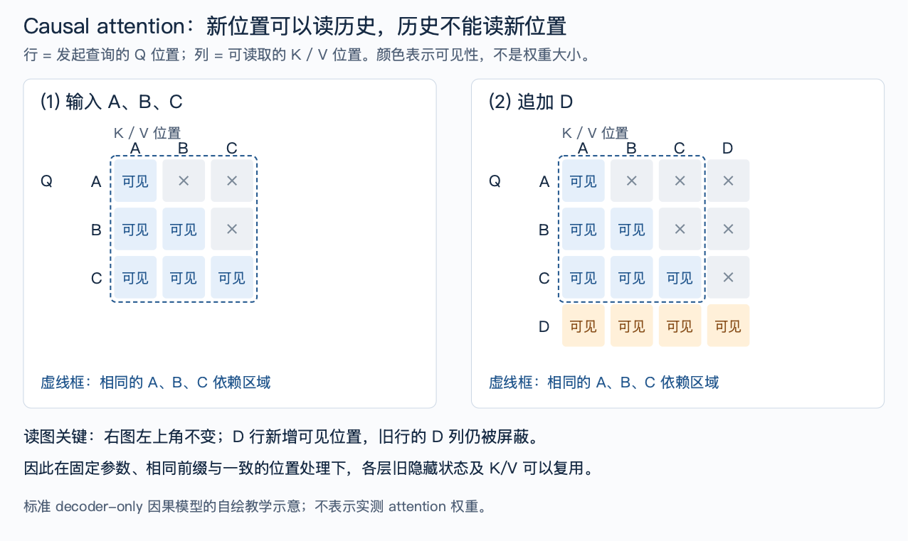
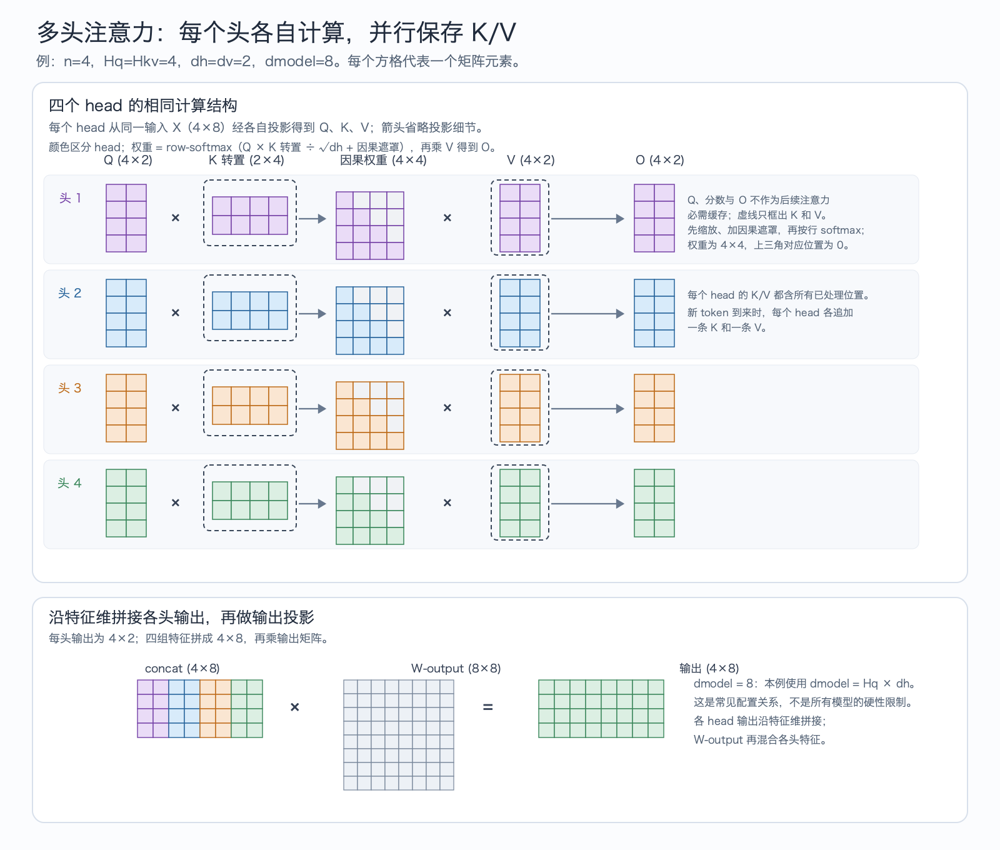
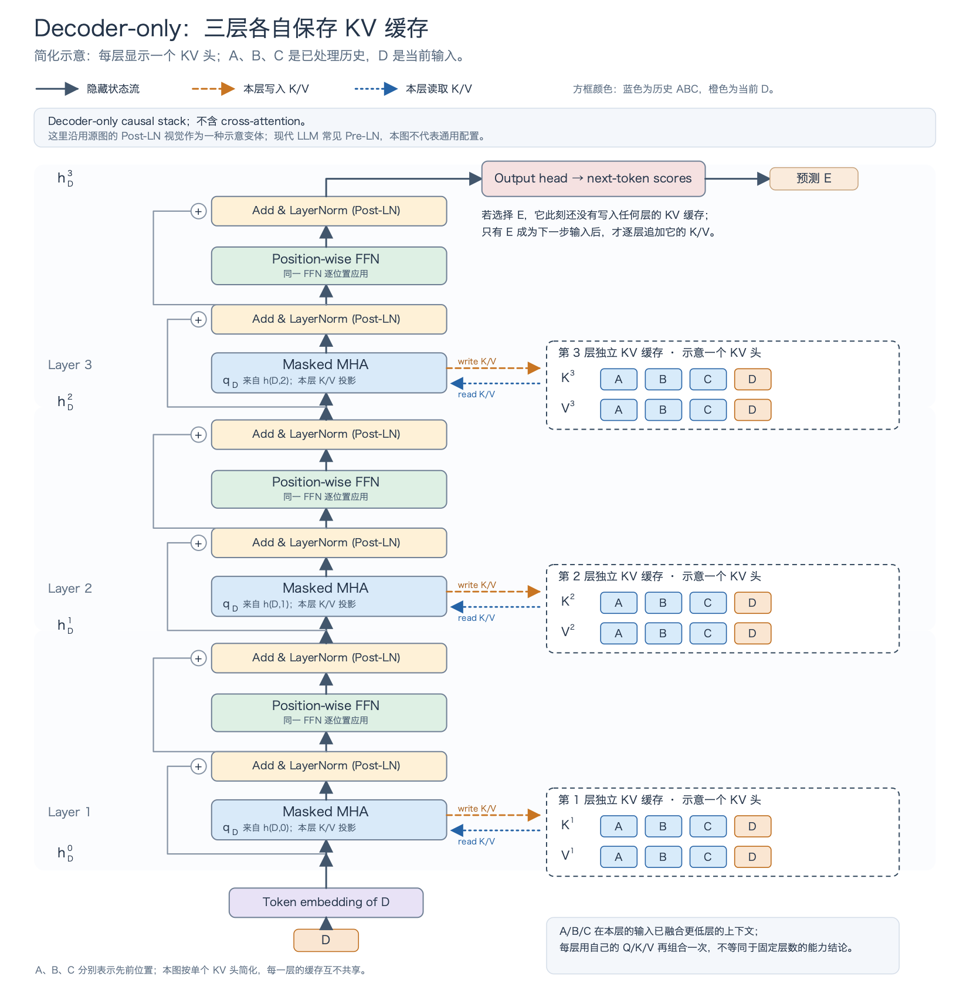
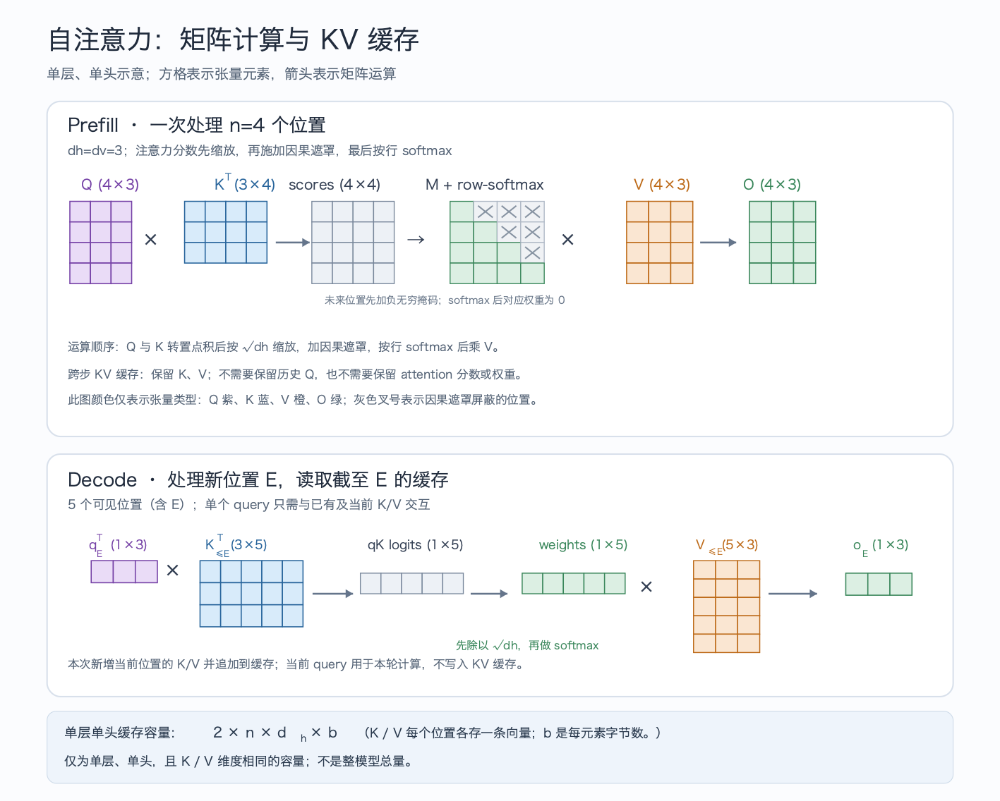
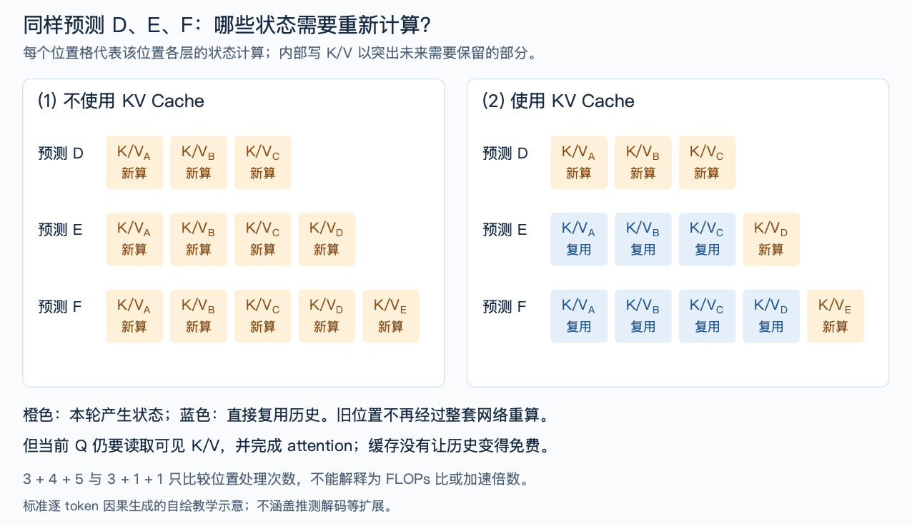
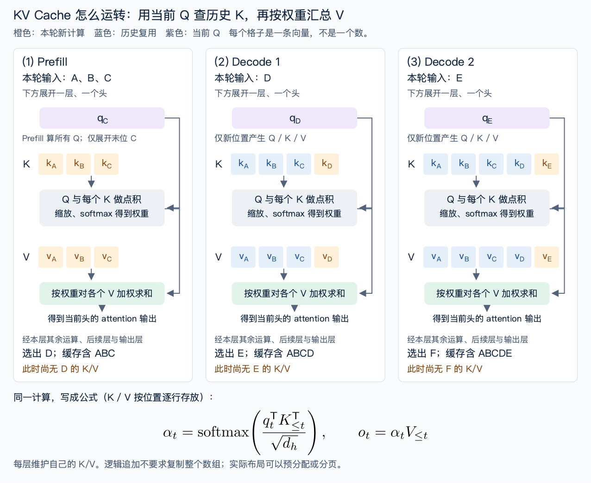

#+TITLE: KV Cache 从哪里来：推理基础、工作过程与问题地图
#+SLUG: kv-cache-fundamentals
#+TYPE: survey-chapter
#+STATUS: published
#+PROGRESS: 100
#+TARGET_ALIAS: categories/AI/KV Cache
#+TARGET_SUB_ID: auto
#+PIN: false
#+SOURCE_URL:
#+TAGS: [KVCache, 推理加速, 注意力]
#+CREATED_AT: 2026-10-28T14:06:46
#+UPDATED_AT: 2026-10-28T18:09:04
#+PUBLISHED_AT: 2026-10-28
#+PUBLISHED_FILE: src/pages/kv-cache-fundamentals.html

* 阅读与审阅记录

本稿按用户授权逐节共写，依据 [[file:kv-cache-user-notes.org][用户口述思路]] 与 [[file:../openspec/changes/kv-cache-research/design.md][七篇文章规划]]。当前完成五节初稿；用户允许继续后，已补第五节优化路线与历史导航，并补上第四节公式前的KV头定义。用户已审阅通过并授权发布；发布准备中按追加反馈补第一节多头attention及矩阵形状图，相关图与全文审校正在完成。根据用户反馈补充三幅SVG教学图，保留SVG源文件并生成WebP插图：因果可见性、缓存逐步状态、重复计算对照。最新修订使用scientific-svg，拆开Q/K匹配与V汇总，并加入LaTeX矢量公式，源片段与组合配置一并保存。它们依据已核验原文独立绘制，不是论文原图或实验结果；Mermaid只作执行顺序的辅助，不能代替缓存与attention图解。重复计算对照已放入第二节，用于说明历史状态的重复计算与复用。

本轮修订：第一章已按场景、注意力、多头、多层Decoder、自回归、Prefill/Decode重排；清理图注中的制作流程说明。Decoder第二版已获用户明确确认，已替换正文与草稿的配图；带宽图及其余旧图修订继续等待确认。本轮修改尚未发布。

* 一、从注意力到文本生成：Prefill与Decode属于哪一个过程

本文讨论一种常见场景：用户向LLM提交文本，模型继续生成回答。许多文本LLM使用因果Decoder构成网络。先了解它怎样在各位置间传递信息，再看它怎样一步步生成文本，就能理解一次生成请求为什么会分成Prefill和Decode两个阶段。 #transformer-2017# #pagedattention-2023#

** 1.1 注意力：当前位置怎样从上下文取信息

模型先把输入文本拆成token，再把每个token映射为向量。一个token可能是一个字、一个词的一部分或其他文本片段；后续各层会不断更新这些向量。在Transformer中，self-attention（自注意力）让每个位置按相关程度汇总可见位置的信息。 #transformer-2017#

先看某一层中的一个注意力头。每个位置的隐藏表示会通过可学习的投影，产生三个向量：Query（Q，查询）、Key（K，键）和Value（V，值）。当前位置的Q与可见位置的K进行匹配，得到一组权重；模型再按这些权重，对相应的V做加权求和。#mqa-2019# #pagedattention-2023#

先用A、B、C、D标记四个序列位置，不对应具体分词。以第4个位置D为例，它的query与A、B、C、D各自的key比较，形成四个分数；经过softmax后得到四个权重，随后用这些权重汇总四个value。这里允许D读取自身；因果掩码屏蔽的是未来位置。

把上述操作写成公式，设当前位置为t，它能读取的位置是1到t，则单头attention的输出为：

\[
 o_t = \sum_{j=1}^{t}
 \underbrace{\frac{\exp(q_t^{\mathsf T} k_j/\sqrt{d_h})}
 {\sum_{r=1}^{t}\exp(q_t^{\mathsf T} k_r/\sqrt{d_h})}}_{\alpha_{tj}}
 v_j.
\]

这里，\(q_t\)是当前位置的query，\(k_j\)和\(v_j\)是第j个位置的key与value，\(d_h\)是query/key向量的维度。先计算点积并缩放，再用softmax将分数变成权重\(\alpha_{tj}\)，最后汇总value。以行向量存储时，这等价于常见的\(\operatorname{softmax}(q_tK_{\le t}^{\mathsf T}/\sqrt{d_h})V_{\le t}\)写法。#pagedattention-2023#

这些attention权重表示如何汇总上下文，不是词表中下一个token的概率。得到这个注意力头的输出后，模型还要完成其他头的组合、输出投影、残差与前馈网络等操作，并继续经过后续层；最后才由输出层计算词表概率。

在用于文本生成的因果注意力中，位置之间的可见关系受到限制：A只能读取自己，B可以读取A、B，C可以读取A、B、C。通过因果掩码，系统可以在同一层并行计算这些位置，同时屏蔽对后续位置的读取。并行发生在各层内部的序列位置维度，各层之间仍然按网络顺序执行。

#+CAPTION: 图 1：因果注意力的可见性矩阵。行是query所在位置，列是可读取的K/V位置；×表示被因果掩码屏蔽。追加D后，过去A、B、C各行的依赖不变，只有新行D可以读取所有已有位置。自绘，依据PagedAttention Background；不是实测attention权重热力图。 #mqa-2019# #pagedattention-2023#

读图时，先固定一行看它能读取哪些列，再比较两张矩阵的左上角。比较两段序列A/B/C与A/B/C/D时，旧位置都不能读取新增的D。后面解释自回归生成与缓存复用时，我们会继续使用这一性质。

** 1.2 多头注意力：同一段上下文，多组Q/K/V分别计算

*** 什么是一个注意力头
前面的公式只描述一个头。真实模型通常会从同一份输入隐藏表示出发，通过不同的可学习投影，产生多组Q、K、V。每一组各自匹配和汇总上下文，得到自己的attention输出；这些并行分支就是注意力头。多头不表示把不同token固定分配给不同头，每个头都可以访问因果掩码允许的上下文。#mqa-2019#

以标准多头注意力（Multi-Head Attention，MHA）为例，设一层输入矩阵为\(X\)，第\(h\)个头使用自己的投影参数：

\[
 Q_h=XW_h^Q,\qquad K_h=XW_h^K,\qquad V_h=XW_h^V.
\]

各头分别计算\(O_h=\operatorname{softmax}(Q_hK_h^{\mathsf T}/\sqrt{d_h}+M)V_h\)，其中\(M\)是因果掩码：可见位置为0，未来位置为负无穷。设query头数为\(H_q\)。模型随后把各头输出沿特征维拼接，再经过输出投影：

\[
 O=\operatorname{Concat}(O_1,\ldots,O_{H_q})W^O.
\]

以常见的等宽MHA为例，模型隐藏维度为\(d_{\mathrm{model}}\)，每头维度取\(d_h=d_{\mathrm{model}}/H_q\)，所以拼接后回到模型宽度；这是常见配置，不是所有注意力变体的硬性要求。这样，头数与每头维度就是两个不同的量。

#+CAPTION: 图 2：四头MHA的矩阵形状：每头Q、K、V为4×2，四个4×2输出拼成4×8，再乘8×8输出投影。虚线框标出需跨步保留的K/V。方块表示单个分量，输出投影会混合各头特征。自绘教学示意。 #transformer-2017#

这就是一层中“多头计算，再合并”的过程。实现通常会把多个头的投影合成一次矩阵运算，不一定真的逐头调用。不同头可以学到不同的匹配方式，但不能预先断言某个头固定负责语法、另一个固定负责语义。#mqa-2019#

** 1.3 从一个注意力层到多层Decoder

注意力只是Decoder块的一部分。标准decoder-only因果模型还会对各位置分别应用前馈网络（FFN），并用残差连接和归一化组织这些运算。原始Transformer的Decoder还包含读取Encoder输出的cross-attention；这里讨论没有独立Encoder memory的文本模型，所以图中省去该支路。图中沿用原始Transformer的Post-LN顺序作示意，现代LLM也常用Pre-LN，具体应以模型实现为准。 #transformer-2017#

为什么要堆叠多层？在同一层里，每个位置的注意力读取上一层提供的表示，不能读取其他位置刚算出的本层输出。进入下一层后，模型就能基于已经结合上下文的表示，再进行一轮匹配、汇总和非线性变换。这样可以形成多轮信息组合；这不意味着单层必然只能理解“表面概念”，也不会让任何位置越过因果掩码读取未来。 #transformer-2017#

最后一层的隐藏表示还会送进输出层，得到词表中下一个token的概率。下图用D到E标记一次预测；接下来再看模型怎样连续执行这样的预测，生成一段文本。

#+CAPTION: 图 3：当前输入D依次经过三层Decoder，每层各自保存历史A/B/C并追加D的K/V。各层输入表示与投影参数不同，不能共用一份缓存；图中每层仅画一个KV头。顶部预测E时，E尚未作为输入处理，因此不在缓存中。紫色残差支路从子层输入分叉，在主干加号处与子层输出相加，再进入LayerNorm。Decoder-only结构示意；Post-LN仅为所选变体。 #transformer-2017# #mqa-2019#

** 1.4 自回归：把刚生成的文本接回输入

现在看一次LLM文本生成。假设输入是“北京是”，模型先预测接下来出现什么，再把选出的内容接回上下文。例如，它可能依次续写“中国”“的”“首都”。这里按词块演示过程，不代表某个真实tokenizer的切分，也不意味着模型只能给出这一种回答。

第一轮根据“北京是”选出“中国”；第二轮根据“北京是中国”选出“的”；第三轮再根据“北京是中国的”选出“首都”。生成后一步时，模型会把自己前一步选出的内容作为条件。这样逐步生成序列，就是自回归生成。 #pagedattention-2023#

为了在后面的图中区分位置，我们把原始prompt记为A、B、C，把随后选出的token依次记为D、E、F：模型先根据ABC预测D，再根据ABCD预测E，然后根据ABCDE预测F。本文讨论标准decoder-only模型、每个请求一次预测一个token；推测解码等扩展暂不纳入这个例子。 #pagedattention-2023#

因此，一次请求中已经给定的prompt和随后逐步生成的部分，处理方式不同：前者的多个位置已经确定，后者要等待上一轮选出新token。推理系统据此将这类生成请求的处理过程分为Prefill和Decode两个阶段。

** 1.5 Prefill：处理已知输入，并预测第一个输出token

用户提交prompt时，A、B、C都已经确定。系统可以把这三个位置一起送进模型，在每一层用矩阵运算处理多个位置。这个处理输入的阶段叫prefill，也常称为预填充。#pagedattention-2023#

完成最后一层后，模型使用输入末尾C位置的表示，经输出层计算下一个token的概率分布。系统按解码规则从中选出D，例如贪心选择概率最大的候选，或按指定分布采样。因此，*第一个输出token通常已经由prefill这次前向产生的分布决定*，不必再把D送进模型才能知道D是什么。#pagedattention-2023#

** 1.6 Decode：处理刚生成的token，预测再下一个

选出D后，系统把D作为下一轮的新输入，计算它在各层的表示，并参考先前的上下文，得到E的概率分布。选出E之后，再处理E以预测F。后续这种逐步推进的阶段叫decode，也常称为增量解码。#pagedattention-2023#

#+begin_src mermaid

flowchart LR
    P["Prefill：处理输入 A、B、C"] --> D["选出 D"]
    D --> S1["Decode 1：处理 D，参考已有上下文"]
    S1 --> E["选出 E"]
    E --> S2["Decode 2：处理 E，参考已有上下文"]
    S2 --> F["选出 F"]

#+end_src

这里要区分“本轮处理哪个token”和“本轮预测哪个token”：处理C是为了预测D，处理D是为了预测E。系统还需要向新位置提供历史信息；KV Cache将解决其中的状态复用问题，后面再展开它怎样建立和更新。

prefill和decode的区别也会影响GPU利用方式。prefill在一层内有多个已知位置可以一起计算；单请求的decode每轮只有一个新位置，跨轮又存在数据依赖。实际服务可以把多个请求放在同一个batch中处理，所以“每个请求新增一个token”不等于“整张GPU只处理一个token”。是否受算力、权重读取还是历史状态读取限制，还要看模型、输入长度、batch和硬件，不能仅凭阶段名称判断。#pagedattention-2023#

把向量按位置逐行放在矩阵里，就能看清运算的形状。现在用矩阵对照这两个阶段。下图另取4个输入位置、每头3维的教学例子：prefill有4行Q，新增第5个位置E时，decode只有1行query。图中的方块表示单个向量分量，与第三节“一个格子表示一整条向量”的状态图粒度不同。#mqa-2019#

#+CAPTION: 图 4：单层单头的张量形状。上方用4个位置、每头3维展示prefill；下方新增第5个位置E，decode只使用一行query。方块表示向量分量，颜色表示张量类型，不表示状态新旧。自绘，依据MQA与PagedAttention；尺寸为教学假设。 #mqa-2019# #pagedattention-2023#

这里画出完整分数和权重矩阵，是为了说明数学关系；高效attention kernel可以分块计算，不一定把整张矩阵同时写入显存。跨步缓存也只需要保存历史K/V，不需要保存这张权重矩阵。#pagedattention-2023#

在线服务还要处理多个长度不同、结束时间不同的请求。Continuous batching（动态批处理）允许系统在生成迭代之间调整批次：已结束的请求退出，等待中的请求在资源允许时加入，不必等整批回答全部生成完。调度器还要决定何时处理prompt、何时继续decode，以及怎样分配和回收KV缓存。因此，批次大小、首token延迟和吞吐需要一起权衡，不能只看单请求的decode速度。#pagedattention-2023#

** 1.7 为什么这些基础会引出缓存

到这里，我们只需要保留三个事实。第一，prompt已经给出的多个位置可以在一层内并行处理，而单请求后续生成要逐步推进。第二，当前token通过attention使用可见位置的K/V。第三，这些K/V存在于各个注意力层中，由该层的隐藏表示产生，不能简单理解成原始词向量或一份自然语言摘要。#mqa-2019# #pagedattention-2023#

各层缓存的具体内容与更新步骤将在第三节配合状态图展开。

接下来就有了一个具体问题：生成D、E、F的过程中，我们反复需要历史位置的K/V；这些历史状态是否必须每一步重新计算？下一节将从不使用缓存的执行过程开始，逐项标出重复计算，再解释因果结构为什么允许保存和复用历史状态。

* 二、为什么需要KV Cache：每一步重算的历史，真的发生变化了吗？

前面已经走通了从A、B、C到D、E、F的生成过程。现在先假设系统不保留中间状态：每选出一个新token，就把整个已知序列重新送进模型。这样能够完成生成，但模型会多次处理相同的历史前缀。

** 2.1 不使用缓存，每一步要重新处理哪些位置

第一次输入A、B、C，模型计算各层的隐藏表示及Q/K/V，并利用末尾C的输出预测D。选出D后，如果这些中间状态已经丢弃，下一轮就重新处理A、B、C、D，以预测E。再下一轮重新处理A、B、C、D、E，以预测F。

随着序列向前推进，历史A、B、C会被一遍遍计算。重复工作不只发生在最初的词向量到K/V的投影：在常见的整段前向实现里，模型还会重新计算旧位置在各层的attention输出、前馈网络和后续隐藏状态，才能再次得到深层K/V。#pagedattention-2023#

图中的每个格子只标出一个位置的K/V相关状态，帮助定位这些重复区域。它不表示整个网络只做K/V投影，也不表示每个格子的计算成本相等。

#+CAPTION: 相同上下文下，无缓存与有缓存的K/V相关状态计算对照。橙色为本轮新算，蓝色为复用。缓存减少重复状态计算，仍须读取历史并计算attention；不是加速倍数或完整算量统计。自绘，依据MQA incremental attention及PagedAttention生成流程。
#+ATTR_ORG: :width 1100

左侧三行使用了不同长度的上下文，却都从A开始重新处理；右侧第一次处理A、B、C，后续只对D、E这样的新位置执行新增状态计算。

** 2.2 多了一个token，为什么旧K/V仍然可以相同

关键在于因果注意力。加入D以后，D可以读取A、B、C，但A、B、C不能回头读取D。在前一节的可见性矩阵里，右上方新增的D列，对旧位置依然被屏蔽。

以C为例，生成D之前，C只能使用A、B、C；把D追加到末尾之后，C仍然只能使用A、B、C。如果模型参数、输入前缀、位置处理与其他推理条件保持一致，那么C在这一层读到的信息没有变化，计算出的表示也无需变化。

这个判断可以沿模型层次继续：对于标准因果Transformer，旧位置在首层的输入没有变化；本层只能读取同样的旧前缀，因而本层输出保持相同。后续层接到相同输入并遵守相同掩码，也保持旧位置的结果。由各层输入投影得到的K/V，因此可以复用。这里讨论数学上的等价；不同kernel和浮点归约顺序可能带来细微数值差异。#pagedattention-2023#

需要保留的条件是“同一个前缀，向末尾追加新位置”。如果修改旧token、改变位置处理，或让过去位置能够访问未来，就不能不加核验地沿用这段推理。相同文字出现在不同前文里，也不保证其深层K/V相同。

** 2.3 省掉的是旧状态重算，保留的是当前对历史的使用

既然旧K/V可以复用，系统就能在首次计算后把它们保存下来。下一轮处理D时，只计算D在各层的新状态，并在attention中读取A、B、C的旧K/V，同时使用D本轮产生的K/V。完成这一轮后，再保留D的K/V供处理E时使用。#mqa-2019# #pagedattention-2023#

当前位置仍需要自己的query；过去query对应的输出已经完成，后续位置会用新的query寻找历史内容。因此，标准生成流程主要保存历史K/V，而不是把历史Q也作为后续attention必需的状态留下。

我们可以用一个简单计数观察“避免重复”的含义。在图中的三个预测步骤里，无缓存路径分别处理3、4、5个位置，总计12次位置处理；有缓存路径先处理3个位置，随后每轮只新增1个，总计5次。

这里的12与5只是“哪些位置需要重新产生状态”的示意计数，*不能据此宣称加速12/5倍*。Prefill与decode的并行程度不同，当前query还要读取不断增长的历史K/V，实际延迟也受权重访问、硬件利用率、batch和实现影响。#mqa-2019#

因此，KV Cache节省的是已经完成的历史状态计算，并没有把模型的历史依赖删除。下一节将把存储状态展开，逐步解释prefill怎样建立各层缓存，以及decode怎样读取和追加。

* 三、缓存怎样工作：Prefill建立，Decode读取与追加

上一节解释了旧状态为什么可以复用。现在把这些状态放回模型的每一层，看看一次生成究竟留下什么，以及下一轮怎样使用它们。为了便于读图，先只看一层中的一个注意力头；batch、多头及具体显存布局留到后面展开。

** 3.1 Prefill之后，缓存里究竟有什么

处理输入A、B、C时，每个注意力层都会计算这三个位置的Q/K/V。本层的attention按因果掩码汇总信息，再将结果经过本层其余运算，传给下一层。下一层根据自己收到的隐藏表示，计算属于这一层的Q/K/V。因而，*不同层保存的是不同的K/V*，不能用一份全局缓存代替所有层的状态。#mqa-2019# #pagedattention-2023#

如果把一个位置的向量画成一行，那么第\(\ell\)层在prefill之后保留的状态可以写成：

\[
 K^{(\ell)}_{\mathrm{cache}}=
 \begin{bmatrix}(k_A^{(\ell)})^{\mathsf T}\\(k_B^{(\ell)})^{\mathsf T}\\(k_C^{(\ell)})^{\mathsf T}\end{bmatrix},
 \qquad
 V^{(\ell)}_{\mathrm{cache}}=
 \begin{bmatrix}(v_A^{(\ell)})^{\mathsf T}\\(v_B^{(\ell)})^{\mathsf T}\\(v_C^{(\ell)})^{\mathsf T}\end{bmatrix}.
\]

在这个简化例子里，K矩阵有3行，每行长度为query/key维度；V也有3行，每行长度为value维度。在许多常见模型中，这两个向量维度相同。图中把每个向量缩成一个格子，因此一个格子不是一个数，而是一个位置在这一层、这个头上的整条K或V向量。

模型完成所有层后，用C位置的最终表示预测D。此时各层缓存都只包含A、B、C：*D已经被选出来，并不意味着D已经经过模型、产生了自己的K/V。*

把一个头的K/V矩阵扩展到多个头后，每层缓存就多了“头”这一维。设batch为\(B\)、缓存位置数为\(S\)、KV头数为\(H_{\mathrm{kv}}\)，并暂设K/V每头维度均为\(d_h\)，则K和V各自的逻辑形状都可记为：

\[
 [B,\ H_{\mathrm{kv}},\ S,\ d_h].
\]

四个维度分别表示请求、头、历史位置和向量分量；这里写的是逻辑维度，物理布局可以调整。Prefill后，历史位置维一次增加prompt长度；单请求的每轮decode，则在各层、各KV头上新增一个位置。#mqa-2019#

** 3.2 Decode一步：用D的query读取历史，再留下D的K/V

下一轮把D送进模型。先看第\(\ell\)层：这一层接收D的隐藏表示，经过本层规定的归一化、投影及位置处理，得到当前位置的\(q_D^{(\ell)}\)、\(k_D^{(\ell)}\)和\(v_D^{(\ell)}\)。具体步骤因模型而异，例如使用RoPE时，要按正确位置处理query和key；这里用符号表示已经适合参与attention的向量。

随后，系统把D的K/V接在已有历史之后。按token所在的维度做逻辑拼接，就得到：

\[
 K^{(\ell)}_{\le D}=\operatorname{append}(K^{(\ell)}_{\mathrm{cache}},k_D^{(\ell)}),
 \qquad
 V^{(\ell)}_{\le D}=\operatorname{append}(V^{(\ell)}_{\mathrm{cache}},v_D^{(\ell)}).
\]

这里的append描述逻辑上的追加，并不要求把整个历史数组复制到一块新内存。实现可以预先分配空间，也可以用分页存储；这些方法改变存储与访问方式，当前位置读取的逻辑内容仍是A、B、C、D。

本轮只有D的query需要执行新增位置的attention。它与四个位置的key计算分数，经过softmax，再对四个value加权求和：

\[
 o_D^{(\ell)}=
 \operatorname{softmax}\!\left(
 \frac{(q_D^{(\ell)})^{\mathsf T}(K^{(\ell)}_{\le D})^{\mathsf T}}{\sqrt{d_h}}
 \right)V^{(\ell)}_{\le D}.
\]

上式把query向量转成一行，输出也按行向量表示。旧K/V直接从缓存读取，D自己的K/V本轮计算；旧位置的query与attention输出都不用重算。D完成本层剩余运算后，将新的隐藏表示送往下一层，下一层再读取自己的历史缓存，执行同样的增量过程。#mqa-2019#

等D走完全部层，输出层才计算E的概率分布。选出E时，每层缓存已经包含A、B、C、D，但仍不包含E。再处理E，才会追加E的K/V并预测F。下面的状态图将这几轮放在一起，读图时可以先看K/V格子的颜色，再看面板底部留下哪些缓存。

#+CAPTION: Prefill与两步decode的KV状态，示意一层、一个头。蓝色为复用历史，橙色为本轮新计算，紫色为本轮query。箭头分别表示Q/K匹配及权重对V的汇总；面板底部说明缓存内容与尚未处理的下一token。自绘，依据MQA与PagedAttention；不代表实际内存布局。
#+ATTR_ORG: :width 1100

Prefill面板只展开末尾C用于预测D的路径；实际prefill也计算A、B位置的Q/K/V与相应输出。Decode面板则只新增当前输入位置的状态，同时读取历史。三个面板中的K/V都包含各自本轮的当前位置，而不是只画此前留下的历史。

** 3.3 为什么保存K/V，而不保存历史Q

处理E时，模型会产生E自己的query，用它去读取A到E的K/V。D的query已经完成了为D汇总上下文的任务，不参与E这一次匹配，因此标准增量attention不需要为了后续生成而保留历史Q。相比之下，D的key还会被后续query匹配，D的value还会参与后续汇总，所以这两类状态需要保存。#mqa-2019#

这也说明，KV Cache不是保存一段“已经生成好的答案”，而是保存各层未来仍要访问的中间向量。在普通的完整历史缓存中，每处理一个新token，每层都会增加相应的K/V；本轮attention还要读取此前积累的内容。

到这里，我们已经说明缓存节省了哪些计算，也看到了它需要付出的存储与读取成本。下一节将分别估算缓存要占多少显存，以及历史变长后，每步读取为什么仍然可能成为瓶颈。

* 四、缓存之后的新问题：存得下，还要读得动

使用缓存以后，旧位置不用每轮重新经过整个模型，但它们的K/V仍然留在设备上。处理下一个token时，模型还要读取这些向量，并计算当前query对历史的attention。因此，除了已经减少的重复计算，我们还需要分别检查显存容量、数据读取和剩余计算。

** 4.1 容量：一个token留下多少缓存

前面已经看到每个注意力层都会保存K/V。计算容量时，还要区分Q头与KV头，因为有些模型会让多个Q头读取同一组K/V。

在MHA中，query头数\(H_q\)与KV头数相等，每个Q头使用自己的K/V。为了减少缓存，模型还可以让若干Q头共享一组K/V：分组查询注意力（Grouped-Query Attention，GQA）采用分组共享，多查询注意力（Multi-Query Attention，MQA）则让所有Q头共享一组K/V。这里把独立的一组K/V称为一个KV头。#gqa-2023# #mqa-2019#

对照下面原图，固定8个Q头：MHA有8个KV头，GQA示例有4个KV头（每2个Q头共享一组K/V），MQA只有1个KV头。每个Q仍可算出自己的注意力权重，但共享者读取相同的K/V。在层数、长度、每头维度和精度都相同时，三者缓存容量依次为MHA的1、1/2和1/8。因此，容量公式必须数KV头，不能直接数Q头。下一篇再讨论这种共享怎样训练、实现和影响质量。 #gqa-2023# #mqa-2019#

[[file:assets/kv-cache-fundamentals/gqa-fig1-gmq-architecture.webp]]

#+CAPTION: 图 7：先看MHA：每个query头有独立K/V；再看GQA，多个query头分组共享；MQA则让所有query头使用同一组K/V。各头的Q仍然独立。（来源：Ainslie et al., GQA, Fig. 1（v3，CC BY 4.0）。） #gqa-2023#

现在沿着“每个位置留下多少K/V”来计算容量。

再考虑各层形状相同、K/V维度相等、使用完整历史缓存的常见结构。设模型有\(L\)层，每层有\(H_{\mathrm{kv}}\)个KV头，每个头的向量维度为\(d_h\)，每个元素占\(b\)字节。一个token在一个头里留下K、V两条向量，因此它在所有层留下的缓存字节数为：

\[
 m_{\mathrm{token}}=2L H_{\mathrm{kv}}d_h b.
\]

前面的2来自K和V，不是两份相同副本。这里数的是KV头，不能直接填入query头数：MHA中两者通常相等，GQA和MQA则会让多个query头共享K/V。共享方式怎样影响容量，下一篇再展开。#mqa-2019#

*** 记住这个容量公式：单请求的KV有效载荷
\[
\boxed{M_{\mathrm{KV}}=2\times n\times d\times h\times l\times b}
\]
2表示K和V；\(n\)是已缓存token数；\(d\)是每个KV头的向量维度；\(h\)是KV头数；\(l\)是Decoder注意力层数；\(b\)是每元素字节数。这里的\(d\)不是整个模型隐藏维度，否则再乘头数就会重复计数；GQA/MQA中的\(h\)也不是Q头数。对应上文记号即\(n=S,d=d_h,h=H_{\mathrm{kv}},l=L\)。该式假设各层同构、K/V等宽，不包含权重和管理开销。

想代入自己的模型配置，可以使用 LMCache官方KV Cache Size Calculator。先用上面的公式理解各因子，再核对工具的配置与单位；缓存容量估算不能直接当成整个推理进程的显存需求。 #lmcache-calculator#

如果同时处理\(B\)个请求，每个请求已经缓存\(S\)个token，就得到：

\[
 M_{\mathrm{KV}}=2LBSH_{\mathrm{kv}}d_h b.
\]

真实请求长度经常不同。此时，在没有跨请求共享的情况下，应把\(BS\)换成各请求缓存长度之和\(\sum_i S_i\)。上式计算的是有效K/V数据；预留空位、分页未填满的空间、索引元数据以及量化参数，都要另外计入。模型权重和推理临时张量也不在式内。若模型采用不同层结构、不同K/V维度或压缩潜在表示，则须按实际保存的张量重新计算，不能机械套用这一公式。#pagedattention-2023#

来看一组明确的假设：32层、8个KV头、每头128维、FP16每元素2字节、单请求。每个token的缓存为：

\[
 2\times32\times8\times128\times2
 =131072\ \mathrm{bytes}=128\ \mathrm{KiB}.
\]

缓存32768个token时，总量就是4GiB。以下数据都由同一公式计算，是理论有效载荷，不是某个模型在GPU上的显存实测。

| 已缓存token数 | 单请求K/V有效容量 | 8个等长请求合计 |
|---------------+------------------+----------------|
|          4096 |          0.5 GiB |          4 GiB |
|          8192 |            1 GiB |          8 GiB |
|         16384 |            2 GiB |         16 GiB |
|         32768 |            4 GiB |         32 GiB |

这说明，长上下文和更多并发请求会同时争用显存。即使模型权重能够放下，也不代表系统还能容纳预期数量的长请求。服务系统还需要为后续生成预留空间，因为每个尚未结束的请求都会继续追加缓存。#pagedattention-2023#

*** 实用入口：LMCache容量计算器

可以在 [[https://docs.lmcache.ai/getting_started/kv_cache_calculator.html][LMCache官方KV Cache Size Calculator]] 代入模型配置估算缓存容量，也可按可用GPU内存反推可缓存token数。先理解容量公式，再核对配置与单位；结果不等于整个推理进程的显存需求。工程实践参考 [[https://docs.lmcache.ai/][LMCache官方文档]]，后续复用与多机篇继续使用。

** 4.2 带宽：缓存没有重算，为什么还会慢

容量描述这些向量放在那里占多少空间；带宽问题则来自每一步把它们读出来的过程。在完整、稠密的因果attention中，当前query仍要与所有可见key匹配，并根据权重汇总相应value。缓存让系统可以直接读取旧向量，但这次读取不会因为向量以前用过就自动消失。#mqa-2019#

可以先建立一个简化的数据量模型：假设每步将每层历史K/V各读取一次，KV共享已充分复用，不计其他张量，那么单步逻辑读取量与当前有效缓存容量是同一数量级。上面的单请求32K例子，对应约4GiB的历史K/V扫描量；写入一个新token的K/V则只有128KiB。上下文越长，扫描历史与追加一个位置之间的差距就越大。

这个扫描量不是硬件计数器测得的HBM流量。实际流量还取决于片上缓存命中、kernel分块、KV头的复用、数据布局和并行方式；不同实现可能产生额外读取。这里用它说明读取需求怎样随历史增长，而不是据此报告实际延迟。

在假定全部扫描数据都来自HBM的进一步简化模型里，数据传输时间至少为“扫描字节数除以可用带宽”。例如，假设可用带宽恰好是1TiB/s，4GiB数据对应约3.9ms。这只是给定假设下的传输时间下界，实际还要处理权重、其他运算及调度，不能把3.9ms当成模型每token的实测延迟。MQA原论文正是从反复加载历史K/V的成本出发，讨论减少KV头带来的收益。#mqa-2019#

** 4.3 剩余计算：单步线性增长，多步还会累积

读取历史以后，模型仍要计算点积、softmax和value加权和。固定层数、头数和向量维度时，完整attention处理一个新query的历史相关计算量随当前序列长度线性增长。这里讨论的是decode的attention部分；投影、前馈网络和输出层也有各自的成本，不能把整个模型的开销都归到历史attention上。

再看连续生成的情况。假设prompt长\(P\)，随后执行\(N\)次单token decode，每轮参与attention的位置数依次为\(P+1\)、\(P+2\)，直到\(P+N\)。各轮历史长度相加得到：

\[
 \sum_{i=1}^{N}(P+i)=NP+\frac{N(N+1)}{2}.
\]

所以，最终驻留缓存按\(P+N\)增长，但多步累计的扫描量和历史attention计算并不是只看最终长度一次，而是要把每轮相加。这两种增长讨论的是不同对象：前者关系到峰值容量，后者关系到整段生成所做的工作。

上述计数只覆盖这\(N\)次decode，不包括prefill的attention，也不把prefill已经选出的首个输出token再算成一次decode。这与前文“处理D才预测E”的时序保持一致。

** 4.4 怎样判断一次优化究竟改善了什么

有了容量、读取和计算的区分，后面比较论文时就不能只看一个“加速倍数”。我们至少需要知道用户等待的哪一段变短了，以及系统是否在相同质量和负载下完成比较。

- *首token延迟（TTFT）*：从请求进入统计起点到收到首个输出token。若从服务入口计时，通常会包含排队、prefill及首token输出相关开销；比较时必须核对计时边界。
- *相邻token间隔（ITL）与每输出token时间（TPOT）*：观察后续输出是否流畅。TPOT常按首token之后的生成耗时除以后续token数计算，具体定义仍须以论文或工具为准。平均值也可能掩盖较长的停顿。
- *吞吐*：单位时间完成多少请求或输出多少token。减少KV占用可能允许更大batch，从而提高吞吐；这不自动意味着固定batch下单请求更快。
- *容量与质量*：同时记录有效缓存字节数、实际峰值显存、可支持的上下文与并发，以及任务质量。丢弃历史或降低精度后，节省多少资源必须与质量变化一起看。

例如，分页主要帮助系统减少显存浪费并管理请求，量化可以减少缓存字节数，选择性读取则试图减少本轮访问的历史。它们针对的问题有所不同，也可能组合使用。下一节将沿着这些具体问题整理优化路线，再把关键论文放回发展历史中。

* 五、从问题到路线：KV Cache怎样继续优化

前面已经说明，KV Cache避免了历史状态重算，却仍要保存和访问历史。研究者因此面对几种不同的任务：让一个token少产生一些缓存、让每份缓存少占一些字节、少保留或少读取一部分历史，以及更有效地分配和复用存储。这些方法处理的对象不同，所以不能只按发表年份把它们排成一条替代链。

** 5.1 改变模型：每个token少产生一些缓存

容量公式中的KV头数和向量维度，来自模型本身。MQA让多个query头共享一组K/V；GQA则在完全独立与全部共享之间分组。这样，模型仍可保留多个query头，但每个位置需要保存的K/V组数减少。#mqa-2019# #gqa-2023#

这条路线通常涉及模型训练或适配，不能假定把任意已有模型的独立KV头直接合并，输出就保持不变。后续架构篇还会考察MLA保存压缩潜在表示的做法；它保存的对象与普通多头K/V不同，需要按实际张量重新推导容量，而不是只修改KV头数。

** 5.2 压缩表示：同一段历史少占一些字节

即使位置数和模型结构不变，也可以降低K/V的存储精度。KV量化针对的是推理过程中产生的缓存，和模型权重量化不是同一件事。以KIVI为例，作者分别考虑K与V的数值特征，采用不同的量化粒度。#kivi-2024#

低位宽数字之外，系统还要保存缩放参数等信息，并可能保留一段高精度状态。读出缓存时也需要相应计算。因此，后文既要计算实际占用，也要核对质量和kernel成本，不能把“2bit”直接解释成整台系统显存缩小八倍或推理快八倍。

** 5.3 选择历史：少保留，与本轮少读取，是两个决定

第一种决定是：哪些旧位置不再保留。驱逐后，它们的完整K/V不再随时可用，后续query若需要这些信息，系统也不能凭空恢复。这类方法以容量和质量之间的取舍为重点；H2O、StreamingLLM和SnapKV将作为后续文章的候选案例，具体决策时点和保留粒度还须逐篇核验。

第二种决定是：缓存仍然保存，但当前这一步只读取其中一部分。Quest根据当前query估计哪些页面值得进一步访问，尝试减少长上下文下的读取工作。它仍然需要访问页面摘要等辅助信息，也不等于消除了全部历史存储。#quest-2024#

两种方法可能组合，但必须分别问：被跳过的位置将来还能不能读取？节省的是驻留容量，还是本步读取量？这两个问题能帮助我们避免把“稀疏attention”和“缩小缓存”混为一谈。

** 5.4 管理与共享：有效数据之外，还有浪费和重复

即使完整保留历史并使用同样的数值精度，服务系统仍可能浪费显存。例如，提前为每个请求预留最大长度，会留下大量尚未使用的空间。PagedAttention把逻辑序列映射到物理缓存块，按需分配，并支持合适场景下的共享和写时复制。它减少的是管理中的浪费及重复，不是把每条K/V向量本身压缩了。#pagedattention-2023#

跨请求还可能出现相同前缀，例如多个请求使用同一段系统提示或同一份文档。此时可以进一步研究前缀复用，避免每次都重新prefill这段公共输入。但能否复用要核对模型、token前缀、位置与其他影响状态的条件；“内容相似”并不足以保证K/V相同。

在系统篇中，我们将把SGLang等框架放到具体执行过程里，分别讨论前缀组织、调度和缓存生命周期。框架可能同时实现多种策略，所以不宜把一个框架名直接当成一种缓存压缩算法。

** 5.5 放在哪里：从单卡显存到多机协作

当单卡显存放不下全部状态，或系统希望让prefill与decode使用不同资源时，还需要决定缓存存在哪里、由谁产生，以及怎样传到下一阶段。CPU内存、其他GPU及跨机器传输，都可能参与这个过程。

把状态移到别处并不会消除其读取成本。系统还要处理传输时间、带宽竞争、缓存命中和请求路由，某些场景也要在搬运与重算之间选择。后续将用CacheGen、Mooncake等候选来源展开这些问题；这一节先确定研究对象，不提前给出未核验的性能结论。

** 5.6 视频生成：先分清时间推进与去噪迭代

视频模型还多了一条需要分清的计算顺序：一方面，模型沿视频时间生成新的帧或chunk；另一方面，当前chunk可能要执行多次去噪。只有弄清哪些状态在这些步骤之间保持不变，才能判断哪些K/V可以复用。

以已读的CausVid为例，模型在chunk之间采用因果依赖，当前chunk可以访问已完成的历史。历史完成后，系统建立相应的clean K/V供后续使用；当前chunk在去噪过程中仍在改变，不能直接把某个中间噪声步的K/V当成永久不变的历史。#causvid-2024#

这也解释了蒸馏与缓存怎样协作：少步蒸馏让当前chunk需要的去噪调用更少，KV复用则减少这些调用中的历史重复处理。两者作用于不同部分，可以共同降低成本；但端到端加速还受写回缓存、VAE和其他运算影响，不能直接把两篇论文的加速倍数相乘。

长视频还会让历史不断增长。Self Forcing讨论rolling KV，只维护有界的近期历史，并通过相应训练适应窗口变化。这里要保留一个关键区别：留下的深层K/V仍可能含有更早历史的影响，所以rolling缓存不是“每次截断输入，再重新计算窗口”所得状态的严格等价替换；质量需要实验验证。#self-forcing-2025#

因此，视频篇会分别讲因果结构、少步蒸馏、训练与推理上下文差异，以及rolling缓存。扩散特征复用虽然也叫缓存，但若保存的不是这里讨论的历史K/V，就应作为相关路线另行说明。

** 5.7 怎样阅读这段发展历史

这里先给出有原文依据的几个时间锚点。年份按首次公开时间标记，机制说明则依据本次实际阅读的版本；论文修订时间与首次公开年份不混用。这不是完整的发明史，也不把以下论文称为各条路线的最早工作。

*** 2019：MQA明确讨论增量解码中的K/V读取成本

MQA不是“第一次提出KV Cache”的证据。它的重要性在于，把历史K/V反复加载的成本与注意力头的组织方式联系起来：既然读取的数据太多，就改变模型产生这些数据的方式。这个问题也为后来理解GQA提供了起点。#mqa-2019#

*** 2023：架构选择与服务管理同时推进

GQA在KV共享程度上提供了中间选择；同年的PagedAttention则从服务系统的分配和共享入手。两者不处理同一个问题：系统完全可以服务一个采用GQA、同时使用分页缓存的模型。因此，这一阶段适合按“结构”和“管理”两条线并排阅读，而不是把分页理解成对GQA的替代。#gqa-2023# #pagedattention-2023#

*** 2024：表示压缩与按需读取进一步细化

KIVI与Quest分别提供了两个清楚的切面：前者改变缓存表示的精度，后者根据当前query减少读取的页面。我们可以借这两个例子理解，少存字节与少读历史怎样各自起作用，再逐步补入同一时期其他工作。#kivi-2024# #quest-2024#

*** 2024—2025：因果视频生成把缓存与少步生成放在一起

CausVid首次公开于2024年；本次阅读的是后续v4版本。Self Forcing首次公开于2025年；本次阅读的是v2版本。前者将因果视频生成、少步蒸馏与历史KV复用结合，后者进一步研究自生成历史参与训练以及rolling缓存。这一演进既涉及推理效率，也涉及训练时见到的上下文能否匹配实际生成过程。#causvid-2024# #self-forcing-2025#

这些锚点足以组织接下来的阅读，但尚不构成截至2026年的完整综述。正式发布前，仍需补齐其他核心论文的原文核验、2025—2026年的覆盖，以及带来源标记的历史图。

** 5.8 后续六篇分别回答什么

完成这篇基础总览后，读者已经能够区分重算、容量与读取成本。后续文章将沿着这些区别继续，而不重复铺开attention基础。

- *注意力结构篇*：MQA、GQA与MLA分别保存什么，为什么更少，训练和实现有什么条件。
- *量化篇*：K/V怎样量化，实际字节数如何计算，误差与反量化成本在哪里。
- *历史选择篇*：永久驱逐和按query跳读分别怎样决策，会失去什么信息。
- *分页与调度篇*：物理空间如何分配、共享与回收，并发请求怎样相互影响。
- *复用与多机篇*：公共前缀怎样复用，prefill/decode分离后怎样搬运和放置缓存。
- *视频篇*：因果chunk、蒸馏、训练上下文和rolling KV怎样配合，哪些状态不能直接复用。

后续比较每种方法时，我们都会回到同一组问题：它改变了哪份状态，省了存储还是读取，是否需要训练，以及代价体现在哪些质量或系统指标上。

* 已写小节参考与回源位置

- #pagedattention-2023# Kwon et al. [[https://arxiv.org/abs/2309.06180][Efficient Memory Management for Large Language Model Serving with PagedAttention]]。原文Background中的Transformer-Based LLMs、LLM Service & Autoregressive Generation、Batching Techniques；已取得并阅读的 [[file:../raw/kv-cache-research/papers/pagedattention/sources/pagedattention.md][原文提取]]。标准单步生成场景不涵盖推测解码等扩展。
- #mqa-2019# Shazeer. [[https://arxiv.org/abs/1911.02150][Fast Transformer Decoding: One Write-Head is All You Need]]。Background: Neural Attention与Dot-Product Attention；[[file:../raw/kv-cache-research/papers/mqa/source-tar/main.tex][原始TeX]]。本文公式保留标准缩放因子，不能依赖丢失数学宏的转换文本。
- 已参考并整合旧Infra入门文章；原稿归档至 archive/llm-inference-infra-intro-source.html.txt。动态批处理内容补入1.6，不沿用“前文摘要”类比。
- #gqa-2023# Ainslie et al. [[https://arxiv.org/abs/2305.13245][GQA: Training Generalized Multi-Query Transformer Models from Multi-Head Checkpoints]]。[[file:../raw/kv-cache-research/papers/gqa/analysis/reading.md][原文阅读记录]]；用于KV共享定义与架构路线。
- #kivi-2024# Liu et al. [[https://arxiv.org/abs/2402.02750][KIVI: A Tuning-Free Asymmetric 2bit Quantization for KV Cache]]。[[file:../raw/kv-cache-research/papers/kivi/analysis/reading.md][定向阅读记录]]；用于K/V非对称量化与存储成本边界。
- #quest-2024# Tang et al. [[https://arxiv.org/abs/2406.10774][Quest: Query-Aware Sparsity for Efficient Long-Context LLM Inference]]。[[file:../raw/kv-cache-research/papers/quest/analysis/reading.md][定向阅读记录]]；用于query相关页面选择，未引用原文存在歧义的预算算例。
- #causvid-2024# [[https://arxiv.org/html/2412.07772v4][CausVid，已读v4原文]]与[[file:../raw/kv-research-causvid/analysis/reading.md][阅读记录]]。历史年份按2024首次公开，机制依据v4；重点回源§4.4与Algorithm 2。
- #self-forcing-2025# [[https://arxiv.org/html/2506.08009v2][Self Forcing，已读v2原文]]与[[file:../raw/kv-research-self-forcing/analysis/reading.md][阅读记录]]。历史年份按2025首次公开，机制依据v2；重点回源§3.2—3.4与rolling讨论。
- #lmcache-docs# [[https://docs.lmcache.ai/][LMCache官方文档]]。
- #lmcache-calculator# [[https://docs.lmcache.ai/getting_started/kv_cache_calculator.html][KV Cache Size Calculator]]；作为容量公式后的实用指路。
